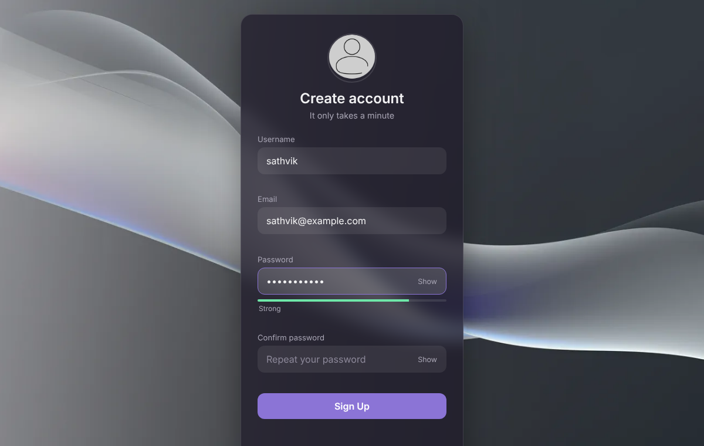

# Login & Sign-Up Pages

**Modern, accessible login and sign-up screens with live form validation, built with plain HTML, CSS and JavaScript.** No frameworks and no build step. Built during an internship (Project 1) and since rebuilt.




## Contents

- [Features](#features)
- [Validation rules](#validation-rules)
- [Running locally](#running-locally)
- [Publishing on GitHub Pages](#publishing-on-github-pages)
- [How accounts are stored](#how-accounts-are-stored)
- [Project structure](#project-structure)
- [Author](#author)

## Features

- Frosted-glass card design that works on phones and desktops
- **Sign up:** username, email, password and confirm password, with live checks
- **Password strength meter:** Weak → Okay → Strong → Very strong
- **Show / hide password** buttons
- **Log in** with any account created on the sign-up page, and an "Incorrect email or password" message otherwise
- **Remember me** fills in your email next time
- Error messages appear under each field and clear as soon as you start fixing it
- Redirects to the login page after a successful sign-up
- Accessible: real `<label>`s, `aria-invalid` on wrong fields, errors announced to screen readers, visible focus outlines, and reduced-motion support

## Validation rules

| Field | Rule |
|---|---|
| Username | 3–20 characters: letters, numbers or `_` |
| Email | Valid format, for example `name@example.com` |
| Password | At least 8 characters, plus a mix of upper and lower case letters, numbers or symbols |
| Confirm password | Must match the password |
| Email on sign-up | Must not already be registered |

## Running locally

The pages use the browser's Web Crypto API, which only works on `https://` or `localhost`, so serve the folder instead of double-clicking the file:

```bash
git clone https://github.com/SathvikRinny/project1-nexus.git
cd project1-nexus
python3 -m http.server 8000
```

Open http://localhost:8000. Create an account on the sign-up page, then log in with it.

## Publishing on GitHub Pages

1. Open **Settings → Pages** in this repository.
2. Choose **Deploy from a branch**, branch `main`, folder `/ (root)`, and click **Save**.
3. The pages will be live at **https://sathvikrinny.github.io/project1-nexus/**.

## How accounts are stored

This is a **front-end demo** with no server:

- Accounts are saved in the browser's `localStorage`, so they exist only in that browser on that device.
- Passwords are hashed with **SHA-256** before saving and are never stored as plain text.
- "Forgot password" explains that a reset needs a backend.

A real application would send the form to a server that stores passwords with a slow, salted hash such as **bcrypt** or **Argon2**, and would manage sessions securely. This project focuses on the user interface and validation.

## Project structure

```
index.html        Login page
signup.html       Sign-up page
style.css         Shared styles
script.js         Validation, strength meter and demo account logic
background.webp   Background image
avatar.webp       Avatar image
docs/             Screenshot for this README
```

## Author

**Sathvik Raju Pothureddy**: [GitHub](https://github.com/SathvikRinny) · [LinkedIn](https://www.linkedin.com/in/sathvik-raju/)
